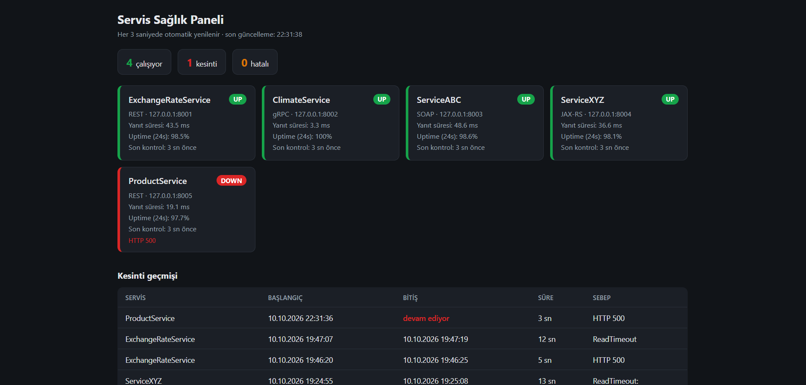
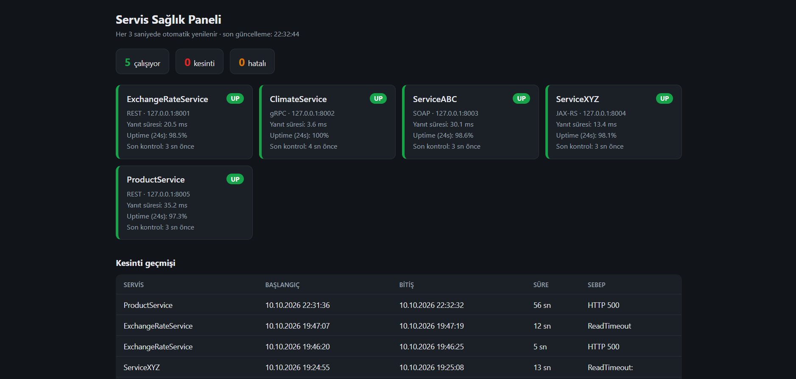
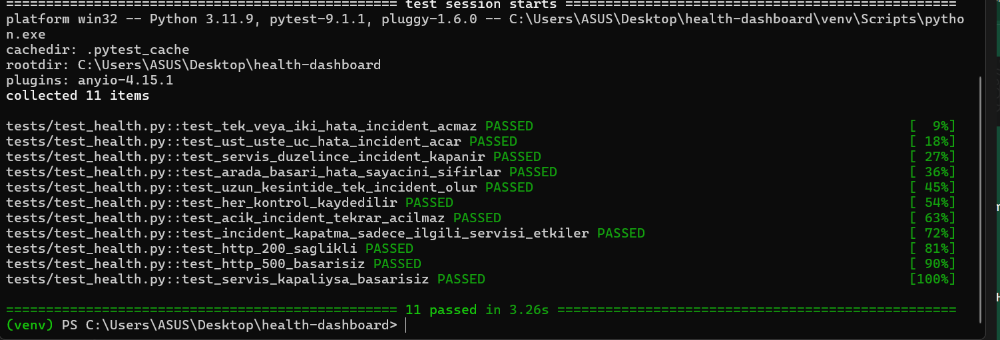

# Servis Sağlık Paneli

Şirket içindeki servislerin (REST, SOAP, JAX-RS, gRPC) `/health` uçlarını düzenli
kontrol eden, kesintileri SQLite'a kaydeden ve web dashboard'unda gösteren uygulama.
Test için sahte servisler ve Chaos Engineering aracı da dahil.

## Mimari

```
config.yaml ──► run_monitor.py ──► SQLite (health.db) ◄── dashboard.py ──► tarayıcı
                    │
                    ▼  her 5 sn, her servis için
              checker (HTTP / gRPC)
                    │
        mock_services.py ◄── chaos_runner.py   (test düzeneği)
```

- **Monitor** (`app/monitor.py`): her servis için ayrı bir asyncio döngüsü. Üst üste
  `failure_threshold` (varsayılan 3) hata olursa servisi DOWN sayar ve incident açar;
  servis düzelince incident kapanır. Tek bir hatalı kontrol DOWN yapmaz.
- **Checker'lar** (`app/checkers.py`): REST, SOAP ve JAX-RS ağ üzerinde HTTP olduğu
  için HTTP GET `/health` kullanır. gRPC için standart `grpc.health.v1.Health/Check`.
- **Veritabanı** (`app/db.py`): `services`, `health_checks` (her kontrol), `incidents` (kesintiler).
- **Dashboard** (`dashboard.py`): servis kartları, 24 saatlik uptime, kesinti geçmişi.
- **Test düzeneği**: `mock_services.py` config'deki servisleri sahte olarak ayağa kaldırır.
  `chaos_runner.py` rastgele servislere arıza enjekte eder.

## Kurulum

```
python -m venv venv
venv\Scripts\activate          # Mac/Linux: source venv/bin/activate
pip install -r requirements.txt
```

## Çalıştırma (her biri ayrı terminalde)

```
python mock_services.py        # sahte servisler + chaos kontrol API (port 9000)
python run_monitor.py          # monitor
python dashboard.py            # http://127.0.0.1:8000
python chaos_runner.py 3       # 3 tur rastgele arıza
```

Gerçek servisleri izlemek için `config.yaml`'daki servis listesini değiştirmek yeterli
(mock servislere ihtiyaç kalmaz).

## Chaos modları

| Mod | Etki |
|---|---|
| `normal` | sağlıklı |
| `error` | HTTP 500 / gRPC NOT_SERVING |
| `slow` | timeout'u aşacak kadar geç yanıt |
| `flaky` | isteklerin yaklaşık yarısı hata verir |

Elle denemek için (PowerShell): `Invoke-RestMethod -Method Post http://127.0.0.1:9000/chaos/ProductService/error`

`chaos_runner.py` yaptığı her şeyi `chaos_log.csv`'ye yazar; bu kayıt ile dashboard'daki
kesinti geçmişi karşılaştırılarak monitor'ün arızaları yakalayıp yakalamadığı doğrulanır.

## Ekran görüntüleri

Chaos ile ProductService bozulduğunda dashboard'da DOWN görünümü:



Servis düzeldikten sonra (kesinti geçmişinde süresiyle kayıtlı):



Testlerin çalıştırılması:



## Testler

```
pip install pytest
python -m pytest -v
```

DOWN eşiği, incident açma/kapama, sayaç sıfırlama ve HTTP checker davranışı test edilir.

## Bilinen sınırlar

- Chaos şu an arızayı HTTP 500 / NOT_SERVING ile simüle eder, süreci gerçekten öldürmez.
- SOAP için SOAP isteği yerine `/health` HTTP kontrolü yapılır.
- Servis listesi `config.yaml`'dan okunur, çalışırken değiştirilemez.
